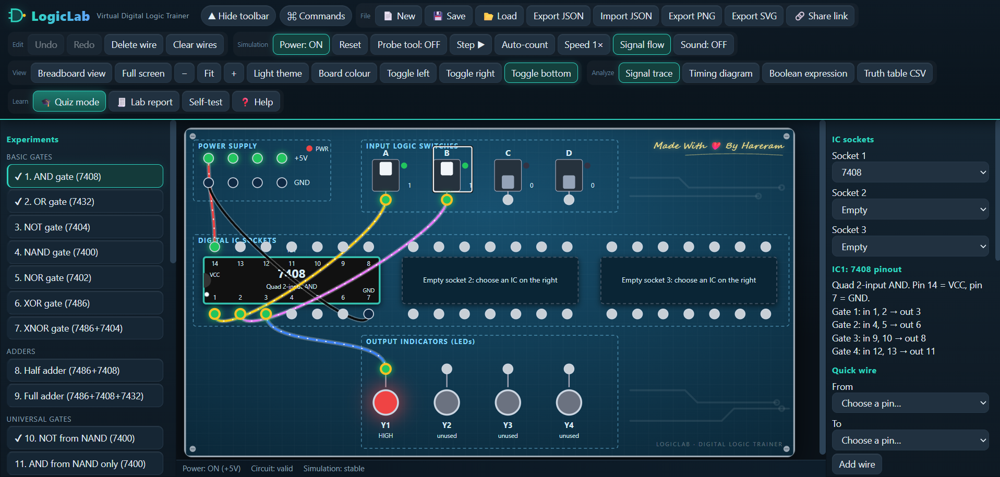
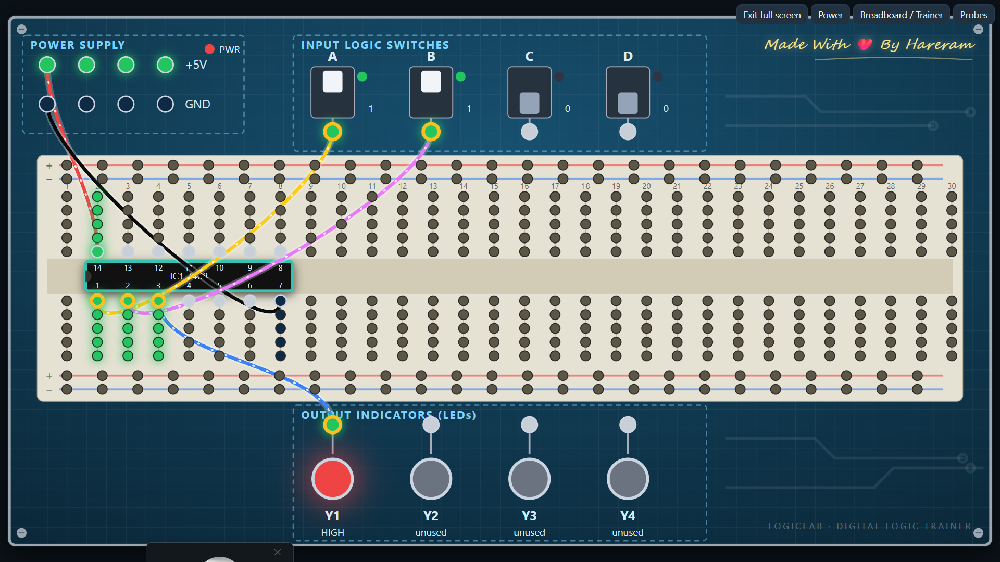
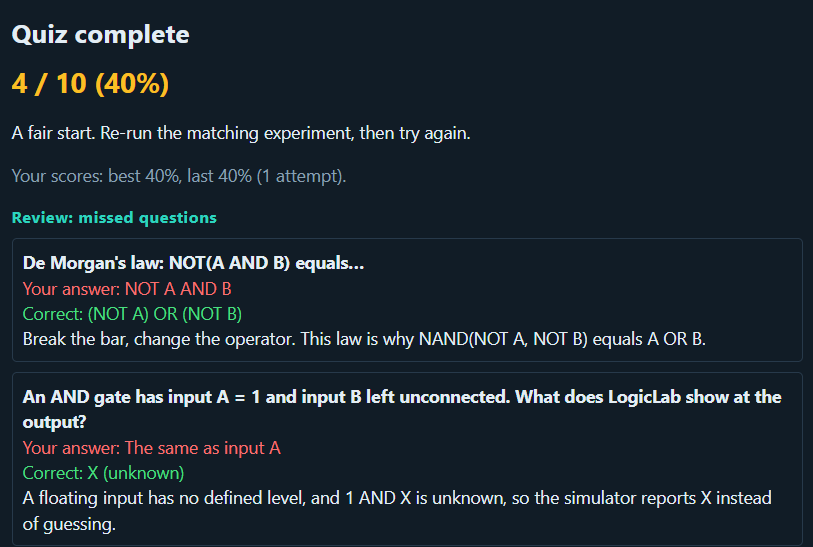

# LogicLab — Virtual Digital Logic Trainer

<p align="center">
  <strong>An interactive, browser-based digital logic laboratory for learning, building, and simulating logic circuits.</strong>
</p>

<p align="center">
  Build circuits · Explore logic gates · Learn digital electronics
</p>

---


---

## Overview

**LogicLab** is a browser-based virtual digital logic trainer designed to help students understand digital electronics and Boolean logic through hands-on experimentation.

Instead of only studying logic gate diagrams and truth tables theoretically, LogicLab lets users interact with switches, connect circuit pins, simulate logic gates, observe LED outputs, build circuits, and explore how digital logic works in real time.

The project combines a virtual logic board, IC-based circuit building, educational experiments, and logic analysis tools in a single application.

It runs directly in a modern web browser without requiring installation or a backend server.

---

## Features

### 🔌 Interactive Circuit Builder
- Build logic circuits by connecting pins.
- Interactive input switches.
- Real-time output LEDs.
- Virtual power supply and ground connections.
- Wire selection and deletion.
- Quick-wire controls.
- Undo and redo functionality.
- Clear circuit connections.

### 🧠 Digital Logic ICs

LogicLab includes support for several commonly used digital logic ICs:

| IC | Function |
|---|---|
| 7400 | Quad 2-input NAND gate |
| 7402 | Quad 2-input NOR gate |
| 7404 | Hex inverter / NOT gate |
| 7408 | Quad 2-input AND gate |
| 7432 | Quad 2-input OR gate |
| 7486 | Quad 2-input XOR gate |

### 🧪 Guided Experiments

Learn and practice through built-in circuit experiments covering:

- AND Gate
- OR Gate
- NOT Gate
- NAND Gate
- NOR Gate
- XOR Gate
- XNOR Gate
- Half Adder
- Full Adder
- NOT using NAND
- AND using NAND
- OR using NAND
- XOR using NAND
- NOR using NAND
- NOT using NOR
- OR using NOR
- AND using NOR
- NAND using NOR
- XNOR using NOR
- XOR using NOR
- XNOR using NAND

Experiments include circuit configurations, objectives, expected outputs, and learning explanations.

### 📊 Logic Analysis Tools

- Automatic truth table generation
- Expected output verification
- Boolean expression analysis
- Sum-of-products expression generation
- Timing diagrams
- Signal tracing
- Signal monitoring
- Circuit warning detection

### 🛠️ Simulation Controls

- Power ON/OFF
- Reset circuits
- Step through input combinations
- Auto-count input combinations
- Adjustable simulation speed
- Signal flow animation
- Optional switch sounds

### 🖥️ Workspace Customization

- Breadboard view
- Fullscreen mode
- Zoom controls
- Dark and light themes
- Multiple board colors
- Show/hide side panels
- Show/hide bottom analysis panel
- Responsive layout

### 💾 Save, Import & Export

- Save circuits in browser storage
- Load saved circuits
- Export circuit configuration as JSON
- Import circuit configuration from JSON
- Export board as PNG
- Export board as SVG
- Export truth tables as CSV
- Share circuits using generated links

### 🎓 Learning & Assessment

- Interactive quiz mode
- Topic-based quiz practice
- Randomized questions and answer choices
- Quiz score tracking
- Best score tracking
- Self-test functionality
- Printable lab reports

---

## Supported Logic Gates

LogicLab supports the following basic Boolean logic operations:

| Gate | Boolean Operation |
|---|---|
| AND | `A AND B` |
| OR | `A OR B` |
| NOT | `NOT A` |
| NAND | `NOT (A AND B)` |
| NOR | `NOT (A OR B)` |
| XOR | `A XOR B` |
| XNOR | `NOT (A XOR B)` |

---

## Example Circuits

### AND Gate

The output becomes HIGH only when both inputs are HIGH.

| A | B | Y |
|---|---|---|
| 0 | 0 | 0 |
| 0 | 1 | 0 |
| 1 | 0 | 0 |
| 1 | 1 | 1 |

Boolean expression:

```text
Y = A AND B
```

### Half Adder

A half adder adds two binary inputs and produces Sum and Carry outputs.

```text
Sum   = A XOR B
Carry = A AND B
```

### Full Adder

A full adder adds three binary inputs: A, B, and Carry-in.

```text
Sum  = A XOR B XOR Cin

Cout = (A AND B) OR ((A XOR B) AND Cin)
```

---

## How to Use

### 1. Open LogicLab

Download or clone the repository and open `index.html` in your browser.

### 2. Select an Experiment

Choose an experiment from the **Experiments** panel to load a predefined circuit.

### 3. Select ICs

Use the IC sockets panel to select the logic ICs required for your circuit.

### 4. Connect the Circuit

Click one pin and then another pin to create a wire between them.

### 5. Power the IC

Connect the IC's power pin to +5V and its ground pin to GND.

### 6. Change Inputs

Click the input switches to change their states between LOW and HIGH.

### 7. Observe Outputs

Watch the LEDs update as the logic circuit is evaluated.

### 8. Analyze the Circuit

Explore the truth table, signal trace, timing diagram, and Boolean expression tools.

---

## Technology Stack

| Technology | Purpose |
|---|---|
| HTML5 | Application structure |
| CSS3 | Styling, layout, themes and responsive interface |
| Vanilla JavaScript | Circuit simulation, interaction and logic evaluation |
| SVG | Virtual circuit board and graphical elements |
| LocalStorage | Local persistence of settings, saved circuits and progress |

**No frameworks or build tools are required.**

---

## Architecture

LogicLab is designed as a self-contained client-side application.

```text
User Interaction
      │
      ▼
Interface & Circuit Board
      │
      ▼
Circuit State
 ├── IC Configuration
 ├── Input Switches
 ├── Wires
 ├── Power State
 └── Breadboard Layout
      │
      ▼
Logic Simulation Engine
 ├── Net Connectivity
 ├── Gate Evaluation
 ├── Signal Propagation
 ├── Conflict Detection
 └── Unknown State Handling
      │
      ▼
Outputs & Analysis
 ├── LEDs
 ├── Truth Tables
 ├── Signal Trace
 ├── Timing Diagram
 └── Boolean Expressions
```

---

## Simulation Concepts

LogicLab uses a circuit connectivity model to evaluate digital logic.

- Connected pins share electrical logic nodes.
- Switches provide digital input values.
- IC gates evaluate their input signals.
- Outputs propagate through connected circuit nodes.
- LEDs display the resulting digital states.
- Floating inputs and conflicting outputs can be detected.
- Unknown signal states are represented internally during simulation.

The simulator also includes iterative evaluation for interconnected logic and detects circuits that do not settle into a stable state.

---

## Keyboard Shortcuts

| Shortcut | Action |
|---|---|
| `Ctrl + K` | Open the command palette |
| `Ctrl + Z` | Undo |
| `Ctrl + Y` | Redo |
| `A` | Toggle input switch A |
| `B` | Toggle input switch B |
| `C` | Toggle input switch C |
| `D` | Toggle input switch D |
| `?` | Open help |
| `Esc` | Cancel/close certain active actions |

*Shortcut behavior may depend on the currently active panel or input.*

---

## Browser Compatibility

LogicLab is intended to work in modern browsers that support:

- SVG
- JavaScript ES6+
- LocalStorage
- Canvas
- Blob and file downloads

---

## Screenshots

Screenshots will be added here to demonstrate the interface and features.

### Main Interface


### Breadboard Mode




### Quiz Mode




---

## Project Goals

LogicLab was created to make digital logic learning more interactive and accessible.

The goals of this project are to:

- Make digital electronics easier to understand.
- Provide a virtual environment for circuit experimentation.
- Help students visualize Boolean logic.
- Reduce the barrier to practicing logic circuits.
- Support learning through simulation and experimentation.
- Combine theory, practical circuit building, and self-assessment.

---

## Future Improvements

Potential future development directions:

- More digital ICs
- Flip-flops and sequential circuits
- Counters and registers
- Multiplexers and demultiplexers
- Encoders and decoders
- 7-segment display support
- More advanced circuit simulations
- Improved circuit editor
- Custom circuit creation challenges
- More experiment modules
- More assessment content
- Additional export formats
- Circuit gallery and sharing improvements

---


<p align="center">
  <b>Learn the logic. Build the circuit. Understand the system.</b>
</p>
